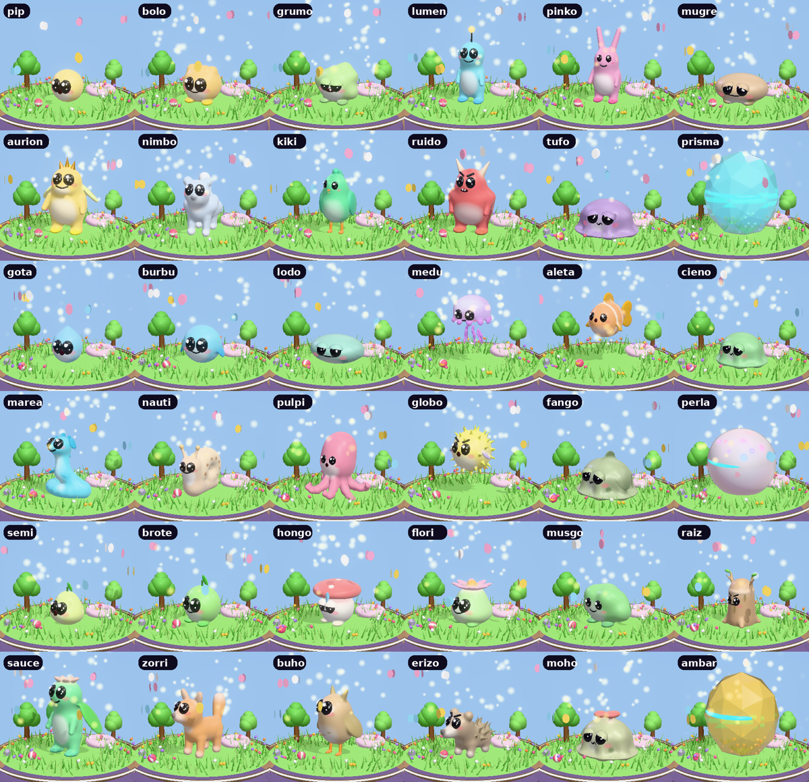
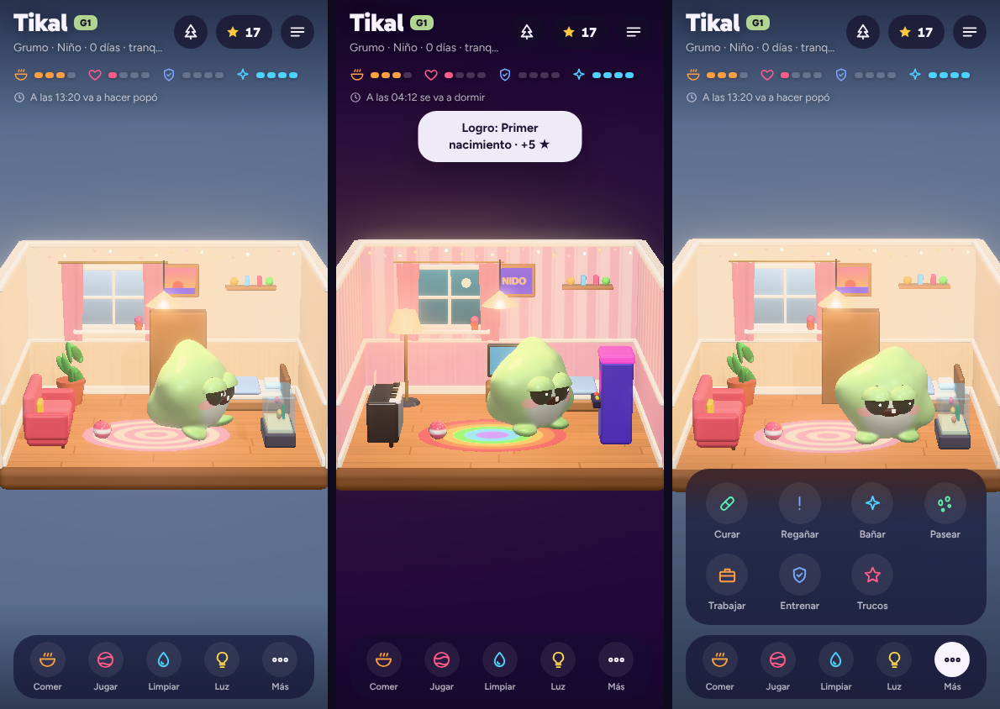
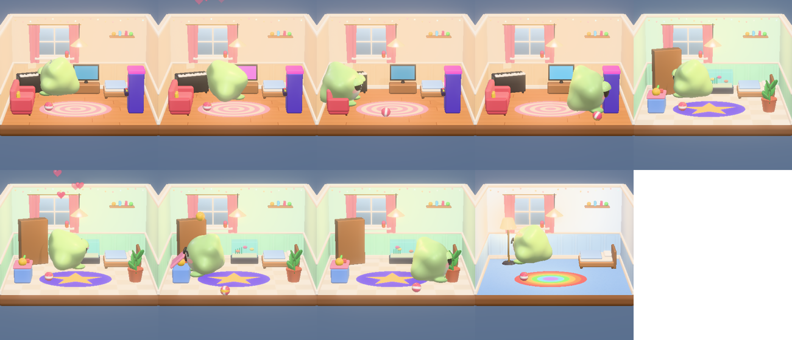
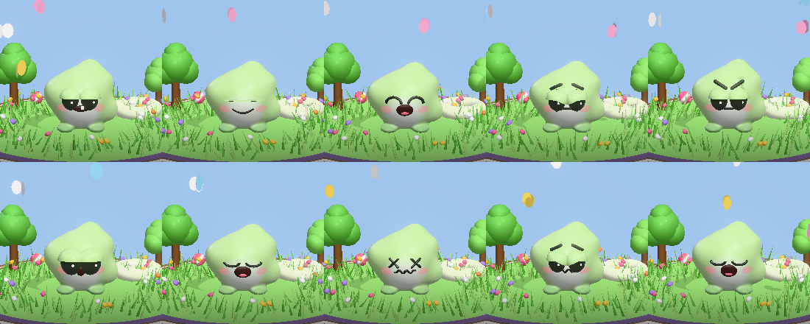
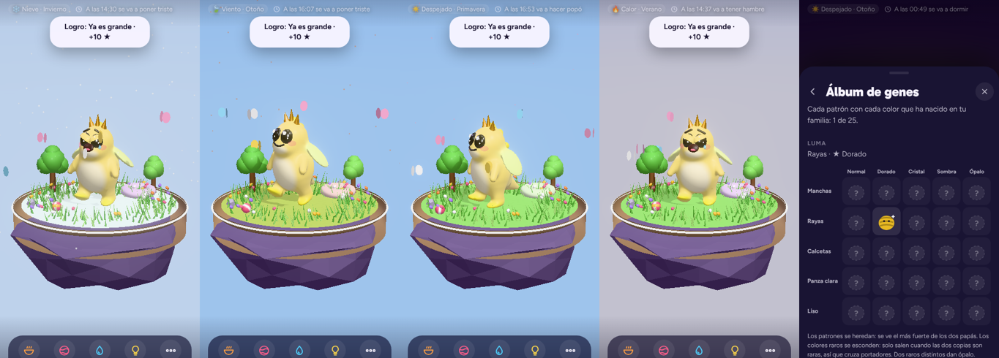
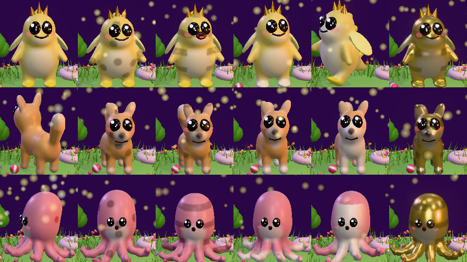

# NIDO

**A real-time virtual pet for your phone, in the spirit of the 1997 pocket pets.**

Raise a creature from an egg to old age. It lives on the real clock: it gets hungry, sleeps, grows up, calls you when it needs something, and keeps living while the app is closed. Play it as a tiny LCD toy (Classic) or as a living 3D world (Modern).

### ▶ Play: **https://clavellina84.github.io/Nido/**

## Install it

NIDO is a web app you install on your home screen. It works offline and does not need an account.

- **iPhone / iPad:** open the link in **Safari** → *Share* → **Add to Home Screen**. Open NIDO from the new icon. Notifications only work from the installed icon (iOS 16.4 or later).
- **Android:** open the link in **Chrome** → menu → **Install app** (or *Add to Home screen*).
- **Desktop:** it also runs in any modern browser; use a narrow window.

When a new version comes out, the app downloads it in the background and offers to reload.

## What you can do

- **Raise it.**
  - Feed it (in 3D, drag the food to its mouth), play, clean, bathe it by scrubbing, give it medicine, scold its tantrums and put it to bed.
  - It grows into one of **36 forms** depending on how you care for it. Three of them are secret.
- **Touch it.** Pet it, tickle it, pick it up, throw it the ball. Its face shows what it feels, and its eyes follow your finger.
- **Its world.**
  - Seven worlds, each with its own life and music.
  - A house to decorate, with furniture it really uses (piano, TV, arcade, aquarium…).
- **Weather and seasons.** Rain, snow, heat and wind follow the season. Outside, the cold, the rain and the heat affect it, so bring it inside or give it a scarf.
- **Genetics.**
  - Patterns pass from parents to children.
  - Rare colors (gold, crystal, shadow and opal) hide in carriers and appear when two carriers marry.
  - Collect them in the gene album.
- **Friends.** Share your code, visit each other, send gifts, travel to your friend's world and, when your creatures are adults, marry them. The couple leaves you an egg with traits from both.
- **And more:** walks with 42 souvenirs, minigames, jobs, tricks, a wardrobe, real holidays (Halloween, Day of the Dead, Christmas…), photo mode, family tree, daily goals and achievements.
- **Notifications** when it needs you, even with the app closed, plus a badge on the icon.
- **Spanish and English.**

| | |
|---|---|
|  |  |
|  |  |
|  | |

## Privacy

Your creature and your progress are stored **only on your phone**. There is no account, no email and no tracking.

The only server is a small service used for two things:
- sending you notifications at the times your phone calculated;
- passing messages between friends: the creature's public card (name, form, colors, genes and where it is) and visits, gifts and wedding requests.

It identifies your phone with a random ID. You can make a backup code from *Settings → Backup*.

## About this repository

This repository contains only the **built app** served by GitHub Pages: `index.html` (the whole game in one file), the service worker, the manifest and the icons. The source code, tests and technical documentation live in a separate private repository.

Current version: **7.6**. Release notes are in the app under *Settings → Version*.

© 2026 clavellina84. All rights reserved.
